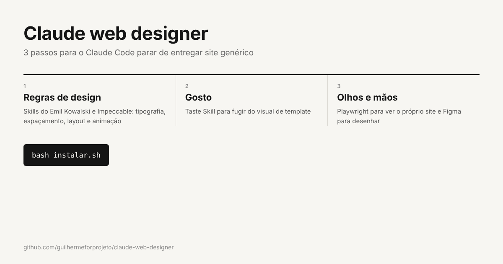

# Claude web designer

**Turn Claude Code into a web designer in 3 steps: design rules, taste and eyes. One command installs everything, and a `CLAUDE.md` makes it design, look at its own work and fix it before handing it over.**

[🇧🇷 Português](README.md) | 🇺🇸 English

Left alone, Claude ships the same landing page every time: centered hero, three cards, purple gradient. With the right tools it follows typography and spacing rules, has an aesthetic direction and can actually **see** the site it built, taking screenshots and fixing what looks off.



---

## Easiest way: send the link to your AI

Open Claude Code (or Cursor, Codex, Copilot) in your project folder and paste:

```text
Read https://github.com/guilhermeforprojeto/claude-web-designer and follow AGENTS.md. I want a website for [describe it here].
```

The AI reads [`AGENTS.md`](AGENTS.md) (in Portuguese; it will still follow it), checks what's installed, asks your permission to install what's missing, asks you the brief questions and builds the site with the workflow below.

## The 3 steps

| Step | Tool | What changes |
|---|---|---|
| **1. Design rules** | [Emil Kowalski's skills](https://emilkowal.ski/ui/agents-with-taste) + [Impeccable](https://github.com/pbakaus/impeccable) | Animation with the right easing and duration, typography, color, spacing and AI anti-pattern detection |
| **2. Taste** | [Taste Skill](https://tasteskill.dev) | Aesthetic direction and less predictable layouts |
| **3. Eyes and hands** | [Playwright MCP](https://github.com/microsoft/playwright-mcp) + [Figma MCP](https://developers.figma.com/docs/figma-mcp-server/) | Opens the site, screenshots it on phone and desktop, and reads from or sends designs to Figma |

## Install

Requires **Node.js 18+** and **Claude Code**.

```bash
bash instalar.sh              # macOS / Linux (add --sem-figma to skip Figma)
.\instalar.ps1                # Windows PowerShell (add -SemFigma to skip Figma)
```

The skills installer may ask which agent to install for: pick **Claude Code**. For Figma, open Claude Code, type `/mcp`, choose `figma` and click **Authenticate**.

<details>
<summary>Prefer running the commands one by one?</summary>

```bash
npx skills add emilkowalski/skill
npx skills add pbakaus/impeccable
npx skills add https://github.com/Leonxlnx/taste-skill --skill design-taste-frontend
claude mcp add --scope user playwright -- npx @playwright/mcp@latest
claude mcp add --scope user --transport http figma https://mcp.figma.com/mcp
```
</details>

## The workflow

Installing the tools isn't enough: Claude needs to know **when** to use each one. Put [`prompts/en.md`](prompts/en.md) in your project's `CLAUDE.md`. It enforces this loop: brief → visual direction → build → Playwright screenshots at 390 px and 1440 px → critique and fix with Impeccable's `/audit` (up to 3 rounds) → deliver with final screenshots and design decisions.

## Pairs well with

[dashboard-sem-cara-de-ia](https://github.com/guilhermeforprojeto/dashboard-sem-cara-de-ia) · [web-moderna-para-ia](https://github.com/guilhermeforprojeto/web-moderna-para-ia) · [seguranca-antes-de-lancar](https://github.com/guilhermeforprojeto/seguranca-antes-de-lancar) · [valide-antes-de-programar](https://github.com/guilhermeforprojeto/valide-antes-de-programar)

## Credits

The 3-step idea comes from a TikTok video by **[@maxcarrau.ia](https://www.tiktok.com/@maxcarrau.ia)**. The tools belong to their authors: [Emil Kowalski](https://emilkowal.ski), [Paul Bakaus](https://github.com/pbakaus/impeccable) (Impeccable), [Leon](https://github.com/Leonxlnx/taste-skill) (Taste Skill), Microsoft (Playwright MCP) and Figma (Figma MCP). This repo only bundles the installation and writes the workflow; it doesn't redistribute any of those skills.

If this helped, a ⭐ helps others find it.

## License

[CC BY 4.0](LICENSE) for this repo's text and scripts. Each installed tool follows its own project's license.
