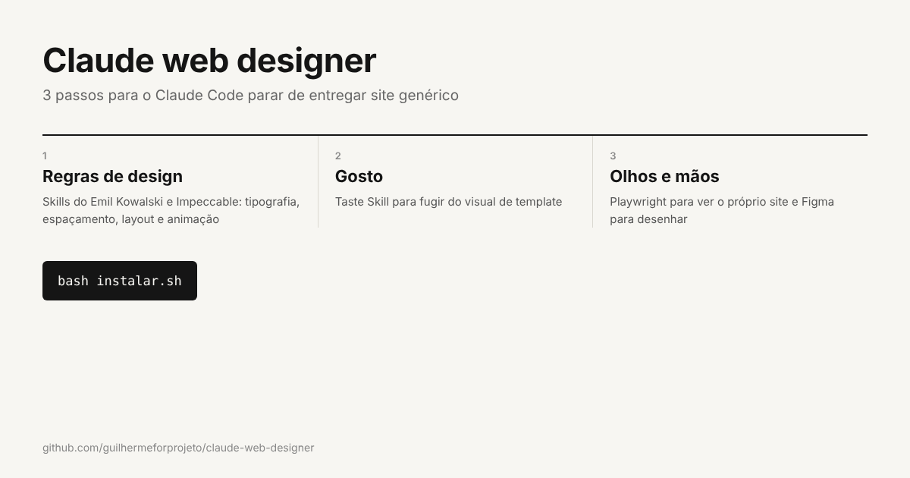

# Claude web designer

**Transforme o Claude Code num web designer em 3 passos: regras de design, gosto e olhos. Um comando instala tudo e um `CLAUDE.md` faz ele desenhar, se olhar e se corrigir antes de te entregar.**

🇧🇷 Português | [🇺🇸 English](README.en.md)

Sem ajuda, o Claude entrega sempre a mesma landing page: herói centralizado, três cards, gradiente roxo. Com as ferramentas certas ele passa a seguir regras de tipografia e espaçamento, tem uma direção estética e consegue **ver** o site que fez, tirando print e corrigindo o que ficou ruim.



---

## Jeito mais fácil: mande o link para a IA

Abra o Claude Code (ou Cursor, Codex, Copilot) na pasta do seu projeto e cole:

```text
Leia https://github.com/guilhermeforprojeto/claude-web-designer e siga o AGENTS.md. Quero um site para [descreva aqui].
```

A IA lê o [`AGENTS.md`](AGENTS.md), confere o que já está instalado, pede sua permissão para instalar o que faltar, te faz as perguntas do brief e constrói o site seguindo o fluxo abaixo.

## Os 3 passos

| Passo | Ferramenta | O que muda |
|---|---|---|
| **1. Regras de design** | [Skills do Emil Kowalski](https://emilkowal.ski/ui/agents-with-taste) + [Impeccable](https://github.com/pbakaus/impeccable) | Animação com easing e duração certos, tipografia, cor, espaçamento e detecção de anti-padrões de IA |
| **2. Gosto** | [Taste Skill](https://tasteskill.dev) | Direção estética e layouts menos previsíveis |
| **3. Olhos e mãos** | [Playwright MCP](https://github.com/microsoft/playwright-mcp) + [Figma MCP](https://developers.figma.com/docs/figma-mcp-server/) | Abre o site, tira print em celular e desktop, e lê ou manda designs para o Figma |

## Instalação

Precisa de **Node.js 18+** e **Claude Code**.

**macOS / Linux**
```bash
bash instalar.sh            # tudo
bash instalar.sh --sem-figma
```

**Windows (PowerShell)**
```powershell
.\instalar.ps1
.\instalar.ps1 -SemFigma
```

Durante a instalação das skills, o instalador pode perguntar para qual agente instalar: escolha **Claude Code**. Para o Figma, abra o Claude Code, digite `/mcp`, escolha `figma` e clique em **Authenticate**.

<details>
<summary>Prefere rodar os comandos um por um?</summary>

```bash
# 1. Regras de design
npx skills add emilkowalski/skill
npx skills add pbakaus/impeccable

# 2. Gosto
npx skills add https://github.com/Leonxlnx/taste-skill --skill design-taste-frontend

# 3. Olhos e mãos
claude mcp add --scope user playwright -- npx @playwright/mcp@latest
claude mcp add --scope user --transport http figma https://mcp.figma.com/mcp
```
</details>

## O fluxo de trabalho (`CLAUDE.md`)

Instalar as ferramentas não basta: o Claude precisa saber **quando** usar cada uma. Copie o [`CLAUDE.md`](CLAUDE.md) para a raiz do seu projeto (ou cole o conteúdo no seu `CLAUDE.md`). Ele obriga este ciclo:

1. **Brief** antes do código: público, ação principal, tom, referências e anti-referência.
2. **Direção visual** em poucas linhas: fontes, paleta, grid e movimento.
3. **Construção** responsiva, com HTML semântico.
4. **Print com o Playwright** em 390 px e 1440 px.
5. **Crítica e correção** com o `/audit` do Impeccable, até 3 rodadas.
6. **Entrega** com os prints finais e as decisões de design.

Depois é só descrever o site que você quer, em português.

## Combina com

- [dashboard-sem-cara-de-ia](https://github.com/guilhermeforprojeto/dashboard-sem-cara-de-ia): os 20 vícios visuais de interface feita por IA.
- [web-moderna-para-ia](https://github.com/guilhermeforprojeto/web-moderna-para-ia): `<dialog>`, `popover`, container queries e outras trocas de legado por nativo.
- [seguranca-antes-de-lancar](https://github.com/guilhermeforprojeto/seguranca-antes-de-lancar): auditoria de segurança antes do deploy.
- [valide-antes-de-programar](https://github.com/guilhermeforprojeto/valide-antes-de-programar): prove a demanda no Google antes de construir.

## Créditos

A ideia dos 3 passos vem de um vídeo do **[@maxcarrau.ia](https://www.tiktok.com/@maxcarrau.ia)** no TikTok. As ferramentas são dos seus autores: [Emil Kowalski](https://emilkowal.ski), [Paul Bakaus](https://github.com/pbakaus/impeccable) (Impeccable), [Leon](https://github.com/Leonxlnx/taste-skill) (Taste Skill), Microsoft (Playwright MCP) e Figma (Figma MCP). Este repositório só junta a instalação e escreve o fluxo de trabalho; não redistribui nenhuma dessas skills.

Se isso te ajudou, deixa uma ⭐. Ajuda mais gente a achar.

## Licença

[CC BY 4.0](LICENSE) para os textos e scripts deste repositório. Cada ferramenta instalada segue a licença do próprio projeto.
